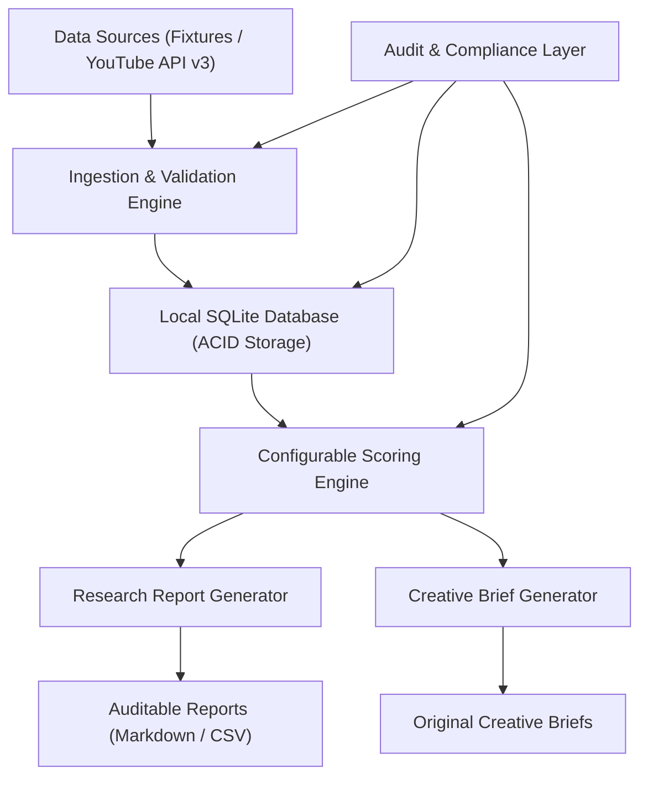

# Architecture Specification — LIDO AI Meditation Music Factory

**Version:** 1.0.0  
**Date:** 2026-10-10  
**Status:** Approved for Phase 0 Dry-Run  

---

## 1. System Overview & Philosophy

The LIDO AI Meditation Music Factory is a local-first, data-driven research and creative curation engine. It analyzes public metadata from Vietnamese and international meditation music spaces on YouTube, calculates multidimensional opportunity scores using versioned formulas, and generates original creative briefs for the LIDO Meditation brand.

---

## 2. Core Architectural Principles

1. **Local-First & Zero CaaS Dependency:** Runs entirely on local infrastructure using Python standard tools and SQLite.
2. **Explicit Data Provenance:** Every single video, channel, score, and generated brief maintains an unalterable audit trace back to its origin (`YOUTUBE_API_V3`, `SYNTHETIC_FIXTURE`, `MANUAL_SEED`).
3. **Deterministic & Versioned Scoring:** Opportunity scoring logic is driven by external JSON configuration files (`scoring_v1.json`). Scores are 100% reproducible given identical input snapshots.
4. **Strict Safety & Rights Verification:** Creative concepts are checked for original composition guidelines. Audio/video downloads and scraping are explicitly blocked by system guards.
5. **Separation of Fact vs. Hypothesis:** Output reports explicitly separate observed empirical metrics (views, publish dates, engagement ratios) from AI hypotheses (estimated audience mood, proposed tempo, target frequency).

---

## 3. Subsystem Architecture

### 3.1 Ingestion & Validation Subsystem
- **Input Handlers:** `YouTubeAPIClient` (when API key present) and `FixtureLoader` (when offline/dry-run).
- **Validation Pipeline:** Schema enforcement, null checks, date format normalization (ISO-8601 UTC), deduplication by platform video ID.

### 3.2 Database Storage Subsystem
- **Engine:** SQLite 3.x with WAL (Write-Ahead Logging) enabled.
- **Relational Schema:** 14 normalized tables enforcing primary keys, foreign keys, unique indexes, and audit event logs.

### 3.3 Scoring & Analytics Subsystem
- **Formula Specification:**
  $$Score = (W_{momentum} \times S_{momentum}) + (W_{engagement} \times S_{engagement}) + (W_{evergreen} \times S_{evergreen}) - (W_{saturation} \times S_{saturation})$$
- **Weight Configuration:** Configurable via external parameters without modifying python codebase.

### 3.4 Brief & Report Generation Subsystem
- **Research Report Output:** Structured Markdown summary + tabular CSV dataset.
- **Creative Brief Output:** Actionable, original production specifications (niche, target frequency, visual atmosphere, instrumentation, title variations, metadata tags).

---

## 4. Operational Boundaries

- **External Action Policy:** Hard-blocked in Phase 0. No auto-publishing, no API spending, no external messaging.
- **Human-in-the-Loop:** All production and publishing tasks are manually executed by the user.
