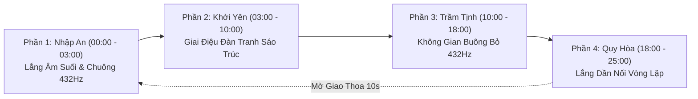

# Creative Brief & Musicful.ai Generation Blueprint — An Yên (Inner Peace)

**Tác phẩm:** An Yên — Inner Peace (LIDO Meditation Original Series)  
**Mã sản phẩm:** `BRIEF_LIDO_MUSIC_002`  
**Thương hiệu:** LIDO Meditation  
**Ngày lập:** 2026-10-10  
**Tần số chữa lành chủ đạo:** 432Hz (Tần số Tự nhiên & Trút bỏ Muộn phiền)  

---

## 1. Bảng Trạng thái Phê duyệt Dự án (Approval Lifecycle Matrix)

| Trạng thái Phê duyệt (Approval State) | Kết quả / Trạng thái Thực tế | Ghi chú & Điều kiện |
| :--- | :--- | :--- |
| **1. Creative Concept Reviewed** | ✅ **PASSED** | Đã hoàn thành nghiên cứu YouTube benchmarks & duyệt định hướng |
| **2. Creative Brief Reviewed** | 🔄 **DRAFT v1.0** | Đã lập bản thiết kế sơ bộ (Chờ ChatGPT Architect review) |
| **3. Production Authorized** | ⏳ **PENDING USER APPROVAL** | Chưa được cấp phép sản xuất (Chờ Chủ dự án duyệt) |
| **4. Audio Generated & Quality-Checked** | ❌ **NOT STARTED** | Chưa có tệp âm thanh thực tế nào được tạo hay đánh giá |
| **5. Publishing Authorized** | ❌ **NOT AUTHORIZED** | Nghiêm cấm xuất bản / đăng tải nội dung |

---

## 2. Triết lý Sáng tạo & Nhận diện Âm thanh 432Hz (Acoustic Identity)

### 2.1 Ý niệm Sáng tạo "An Yên"
"An Yên" hướng người nghe đến trạng thái **trút bỏ mọi lo âu, xoa dịu tâm trí căng thẳng, buông bỏ muộn phiền và tìm lại sự bình an nội tại**. Khác với "Vô Thường" (tần số 528Hz thiên về tái tạo năng lượng), "An Yên" chọn tần số **432Hz** — tần số hòa hợp tự nhiên của trái đất giúp hạ nhịp tim và đưa sóng não về trạng thái Alpha/Theta thư thái sâu.

### 2.2 Cấu trúc Đa lớp Âm thanh Thuần Acoustic (100% Pure Acoustic Layering)
- **Lớp Dẫn dắt (Foreground Lead):** Đàn Tranh Việt Nam 16 dây (nhấn rung nốt mộc) hòa tấu cùng Sáo Trúc/Tiêu trầm và tiếng rải Guitar thùng mộc dịu êm.
- **Lớp Tần số Chữa lành Ngầm (Low-Mid Harmonic Layer):** Chuông xoay Tây Tạng dải tần **432Hz** ngân dải trầm/trung liên tục tạo nền âm vững chãi.
- **Lớp Tiếng Thiên nhiên Ngầm (Environmental Layer -20dB):** Âm thanh suối núi chảy ngầm róc rách & gió lướt qua rừng trúc tĩnh lặng.
- **Giới hạn nghiêm ngặt (Hard Constraints):**
  - ❌ **KHÔNG** giọng hát người (Zero vocals).
  - ❌ **KHÔNG** trống hay nhịp điệu percussion (Zero drums/beats).
  - ❌ **KHÔNG** nhạc cụ tổng hợp điện tử (Zero synth pads / EDM / Pop).

---

## 3. Musicful.ai Generation Prompts (Tần số 432Hz)

### 3.1 Master Layered Prompt (Tiếng Anh — Copy dán trực tiếp vào Musicful.ai / Suno)
```text
Extended tranquil Vietnamese acoustic meditation soundscape tuned to 432Hz natural frequency, lead traditional 16-string Dan Tranh zither with expressive organic note bending, paired with deep acoustic bamboo flute Tiêu and soft dampened acoustic guitar. Resonant low-mid background layer of continuous 432Hz Tibetan singing bowl drone, mixed with soft mountain stream water and gentle bamboo forest ambience. Peaceful, serene, 55 BPM, pentatonic scale, no vocals, no drums, no percussion, no electronic synth pads, 100 percent pure acoustic instruments.
```

### 3.2 Short Layered Prompt (Dành cho giao diện ngắn)
```text
Vietnamese Dan Tranh zither, bamboo flute Xiao, soft acoustic guitar, subtle low 432Hz Tibetan singing bowl drone, mountain stream water, 55 BPM pentatonic meditation, no vocals, no drums, no synths.
```

### 3.3 Negative Prompt / Exclude Styles (Ô loại trừ)
```text
vocals, singing, voice, choir, drums, percussion, beats, EDM, pop, synth, synth pads, distorted audio, fast tempo, heavy bass, loud water, loud rain, 440Hz tuning
```

---

## 4. Cài đặt Thông số Kỹ thuật Cho Musicful.ai

- **Instrumental Mode:** **ON** (Toggle Bật)
- **Weirdness (Creativity):** **`0.40`** (Tạo giai điệu mượt mà, ổn định)
- **Influence (Style Weight):** **`0.85`** (Ép AI tuân thủ nghiêm ngặt nhạc cụ acoustic)
- **Tempo:** **`55 BPM`** (Nhịp chậm điều hòa nhịp thở)

---

## 5. Thiết kế Đề xuất Cấu trúc Hòa tấu (Proposed Technical Design)

> [!NOTE]
> Bố cục phân đoạn 25 phút và thiết kế nối lặp 1–3 giờ dưới đây là **Đề xuất Thiết kế Lý thuyết**, chưa được kiểm chứng cho tới khi tạo tệp audio.



---

## 6. Tiêu chí Đánh giá Chất lượng Âm nhạc (Evaluation Criteria)

| Tiêu chí | Trọng số | Mô tả Yêu cầu Đạt |
| :--- | :--- | :--- |
| **1. Âm sắc Nhạc cụ (Timbre Quality)** | 25% | Đàn Tranh & Sáo Trúc mộc dịu; tiếng Guitar thùng rải êm; chuông xoay 432Hz trầm ấm. |
| **2. Giai điệu & Ngữ điệu (Melody)** | 20% | Mang đậm âm hưởng Ngũ cung Đông Á (Điệu Nam), thanh thoát, trôi chảy. |
| **3. Định hướng Thư thái 432Hz** | 25% | **Giả định:** Hỗ trợ giải tỏa lo âu, trút bỏ muộn phiền (Chưa đo lường thực tế). |
| **4. Độ Tự nhiên 3D (Natural Ambiance)** | 15% | Tiếng suối & gió rừng trúc trộn nhẹ ở mức -20dB, không làm át giai điệu chính. |
| **5. Tính Nguyên bản (Originality)** | 15% | Đạt chứng nhận 100% độc bản, không copy giai điệu của người khác. |

---

## 7. Danh mục Giả định & Tuyên bố Chưa Kiểm chứng (Unverified Claims Register)

> [!IMPORTANT]
> 1. **Hiệu ứng Tần số 432Hz & Sóng Não (Alpha/Theta):** Đây là mục tiêu thiết kế lý thuyết, chưa được đo đạc phổ âm thanh hay thực nghiệm y tế trên file audio.
> 2. **Độ Mượt Vòng Lặp 1–3 Giờ:** Chưa được kiểm chứng do tệp âm thanh chưa được tạo ra.
