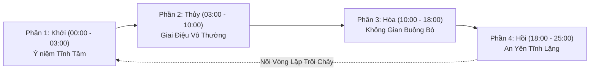

# Creative Brief & Musicful.ai Generation Blueprint — Vô Thường (Impermanence)

**Tác phẩm:** Vô Thường — Impermanence (LIDO Meditation Original Series)  
**Mã sản phẩm:** `BRIEF_LIDO_MUSIC_001`  
**Thương hiệu:** LIDO Meditation  
**Ngày lập:** 2026-10-10 (Hiệu chỉnh v1.1)  

---

## 1. Bảng Trạng thái Phê duyệt Dự án (Approval Lifecycle Matrix)

| Trạng thái Phê duyệt (Approval State) | Kết quả / Trạng thái Thực tế | Ghi chú & Điều kiện |
| :--- | :--- | :--- |
| **1. Creative Concept Reviewed** | ✅ **PASSED** | Đã được ChatGPT Chief Architect duyệt về định hướng nội dung |
| **2. Creative Brief Reviewed** | 🔄 **REVISED DRAFT** | Đã hiệu chỉnh theo phản hồi kiểm toán v1.1 |
| **3. Production Authorized** | ⏳ **PENDING USER APPROVAL** | Chưa được cấp phép sản xuất (Chờ Chủ dự án duyệt) |
| **4. Audio Generated & Quality-Checked** | ❌ **NOT STARTED** | Chưa có tệp âm thanh thực tế nào được tạo hay đánh giá |
| **5. Publishing Authorized** | ❌ **NOT AUTHORIZED** | Nghiêm cấm xuất bản / đăng tải nội dung |

---

## 2. Triết lý Sáng tạo & Định vị Thương hiệu LIDO Meditation

### 2.1 Khái niệm & Ý niệm Sáng tạo "Vô Thường"
"Vô Thường" (Impermanence) thể hiện sự trôi chảy tự nhiên của thời gian và vạn vật. Âm nhạc không hướng người nghe vào sự u buồn hay luyến tiếc, mà mang lại cảm giác **thanh thản, buông bỏ suy nghĩ (mindfulness), chấp nhận và tĩnh tại trong từng khoảnh khắc hiện tại**.

### 2.2 Nhận diện Âm thanh Thuần Acoustic (100% Pure Acoustic Identity)
- **Đặc trưng:** Âm hưởng Thiền Cổ điển Á Đông thuần Acoustic (Pure Oriental Acoustic Meditation).
- **Âm sắc chủ đạo:** Tiếng Đàn Tranh Việt Nam trong trẻo, sâu lắng kết hợp sáo trúc trầm, chuông xoay Tây Tạng ngân xa và âm thanh thiên nhiên tự nhiên.
- **Giới hạn nghiêm ngặt (Hard Constraints):**
  - ❌ **KHÔNG** sử dụng giọng hát người (Zero human vocals/choral layers).
  - ❌ **KHÔNG** sử dụng trống, beat nhịp điệu hay percussion (Zero drums/rhythmic percussion).
  - ❌ **KHÔNG** sử dụng nhạc cụ điện tử Pop/EDM hay âm tổng hợp (Zero synth pads / electronic synthesizers).
  - ✅ **CHỈ** sử dụng hòa tấu 100% nhạc cụ dân tộc acoustic, chuông xoay thiền và âm thanh thiên nhiên thuần khiết.

---

## 3. Musicful.ai Generation Prompts (Hiệu chỉnh Thuần Acoustic)

Các prompt dưới đây được tinh chỉnh để đảm bảo 100% nhạc cụ acoustic, loại bỏ hoàn toàn các thuật ngữ âm tổng hợp (synthesizer/pad):

### 3.1 Master Prompt (Tiếng Anh — Dùng trực tiếp cho Musicful.ai)
```text
Extended meditative Asian acoustic soundscape, leading traditional Vietnamese Dan Tranh 16-string zither with expressive organic bending notes, paired with deep acoustic bamboo flute Xiao and continuous resonant 528Hz Tibetan singing bowls. Gentle natural mountain stream water flowing, soft wooden wind chimes, spatial warmth. Meditative, peaceful, slow tempo, 60 BPM equivalent flow, pentatonic scale, no vocals, no drums, no percussion, no electronic synth pads, no electronic beats, 100 percent pure acoustic instruments.
```

### 3.2 Short Prompt (Dành cho giao diện giới hạn ký tự)
```text
Vietnamese Dan Tranh zither, bamboo flute Xiao, 528Hz Tibetan singing bowl, gentle stream atmosphere, meditative pentatonic melody, peaceful acoustic soundscape, no vocals, no drums, no synths.
```

### 3.3 Phân tích Cấu trúc Prompt
- **Lead Instrument:** `Vietnamese Dan Tranh 16-string zither with expressive organic bending notes` (Tái hiện kỹ thuật nhấn nhấn nhá, rung ngón đặc trưng của Đàn Tranh).
- **Harmonic Foundation:** `Continuous resonant 528Hz Tibetan singing bowls` (Nền chuông xoay Tây Tạng mộc ngân xa).
- **Secondary Melody:** `Deep acoustic bamboo flute Xiao` (Tạo độ bay bổng, thanh thoát giữa các quãng nghỉ của Đàn Tranh).
- **Environmental Texture:** `Gentle natural mountain stream water flowing, soft wooden wind chimes` (Âm thanh suối suối và chuông gió mộc tự nhiên).

---

## 4. Thiết kế Đề xuất Cấu trúc Hòa tấu & Diễn biến Cảm xúc (Proposed Design)

> [!NOTE]
> Tất cả phân đoạn 25 phút, thiết kế mở rộng 1–3 giờ và kỹ thuật chuyển đoạn 10 giây dưới đây đều là **Đề xuất Thiết kế Lý thuyết (Proposed Technical Designs)**. Cần được kiểm chứng thực tế sau khi tạo tệp âm thanh.



| Phân đoạn | Thời lượng Đề xuất | Nhạc cụ & Âm thanh chính | Ý niệm Cảm xúc (Mục tiêu Đề xuất) |
| :--- | :--- | :--- | :--- |
| **Phần 1: Khởi (Prelude)** | 00:00 - 03:00 | Tiếng suối chảy nhẹ, chuông xoay 528Hz ngân dài, tiếng gió qua rừng trúc. | Định hướng mục tiêu giúp thả lỏng tâm trí, tạo sự thư thái ban đầu. |
| **Phần 2: Thủy (Theme)** | 03:00 - 10:00 | Đàn Tranh cất giai điệu Ngũ cung (Hò, Xự, Xang, Xê, Cống) chủ đạo, sáo trúc đáp từ xa. | Thể hiện ý niệm vẻ đẹp mong mong, biến đổi của vạn vật ("Vô Thường"). |
| **Phần 3: Hòa (Deep Space)** | 10:00 - 18:00 | Đàn Tranh rải các nốt đơn thưa thớt trên nền chuông xoay & tiếng suối tự nhiên. | Định hướng không gian yên tĩnh cho trải nghiệm lắng nghe thiền định. |
| **Phần 4: Hồi (Resolution)** | 18:00 - 25:00 | Chuông xoay trầm ngân vang, sáo trúc thổi nốt dài lắng dần vào tiếng suối mộc. | Thiết kế lắng dần để nối vòng lặp (Crossfade đề xuất 10 giây) mượt mà. |

---

## 5. Chiến lược Đề xuất Phát triển Bản nhạc Dài (Hạn chế Lặp nhàm chán)

1. **Biến tấu Nốt & Điệu Ngũ Cung:** Giai điệu Đàn Tranh được đề xuất biến tấu dạo nốt và giãn khoảng nghỉ (Rest Intervals 2–5 giây) giữa các cụm giai điệu.
2. **Lớp Âm thanh Tự nhiên Không Lặp:** Âm thanh suối chảy và tiếng gió tự nhiên có tần số biến đổi ngẫu nhiên.
3. **Khoảng Lắng Nghơi Acoustic (Acoustic Breathing Space):** Đề xuất ngắt giai điệu chính sau 8–10 phút hòa tấu, chỉ giữ tiếng chuông xoay và suối chảy trong 1–2 phút cho không gian tĩnh lặng.
4. **Vòng lặp Chuyển đoạn Đề xuất (Proposed Crossfade Looping):** Cuối bản nhạc (Phần 4) chuyển tiếp về Phần 1 bằng kỹ thuật mờ giao thoa 10 giây (cần kiểm chứng độ mượt khi ghép nối audio thực tế).

---

## 6. Tiêu chí Đánh giá Chất lượng Âm nhạc (Evaluation Criteria)

| Tiêu chí | Trọng số | Mô tả Yêu cầu Đạt (Yêu cầu Kiểm chứng) |
| :--- | :--- | :--- |
| **1. Âm sắc Nhạc cụ (Timbre Quality)** | 25% | Đàn Tranh có âm sắc đanh mộc tự nhiên; sáo trúc mềm mại; chuông xoay ngân dải dải tần rõ ràng. |
| **2. Giai điệu Ngũ cung (Melody & Harmonics)** | 20% | Mang đậm âm hưởng Ngũ cung Đông Á, dịu êm, không chứa các nốt gắt (dissonant). |
| **3. Định hướng Mục tiêu Thiền (Target Meditative Intent)** | 25% | **Giả định định hướng:** Hỗ trợ không gian tĩnh tâm, giảm căng thẳng. (Chưa kiểm chứng đo lường thực tế). |
| **4. Độ Tự nhiên & Không khí (Natural Ambiance)** | 15% | Âm thanh suối chảy, gió reo mộc tự nhiên, không bị chói đập (clipping) hay rè nền. |
| **5. Tính Nguyên bản (Originality & Rights)** | 15% | Đạt chứng nhận 100% composition gốc, không copy melody hay đoạn thu của bất kỳ nghệ sĩ nào khác. |

---

## 7. Danh mục Giả định & Tuyên bố Chưa Kiểm chứng (Unverified Claims Register)

> [!IMPORTANT]
> Toàn bộ các tuyên bố dưới đây là **Mục tiêu Sáng tạo & Giả định Lý thuyết (Creative Intentions & Hypotheses)**, **CHƯA được kiểm chứng bằng thực nghiệm âm thanh**:
> 1. **Hiệu ứng Tần số 528Hz & Sóng Não (Alpha/Theta/Delta):** Chưa có thực nghiệm y khoa hay đo đạc phổ âm thanh thực tế trên tệp audio.
> 2. **Tác dụng Thư giãn, Giảm Stress & Ngủ ngon:** Đây là định hướng cảm xúc lý thuyết của sản phẩm, không phải kết quả thực nghiệm y tế đã chứng minh.
> 3. **Độ Mượt của Vòng lặp 1–3 Giờ & Crossfade 10 Giây:** Chưa được kiểm chứng do tệp audio chưa được khởi tạo.
