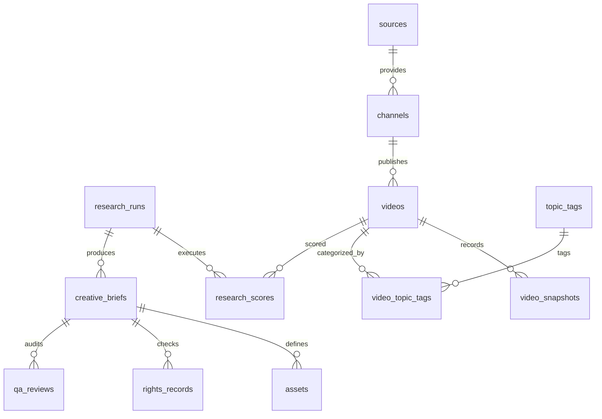

# Database Schema Specification — LIDO AI Meditation Music Factory

**Version:** 1.0.0  
**Database Engine:** SQLite 3.x (WAL mode)  
**Date:** 2026-10-10  

---

## 1. Relational Schema Overview

The database consists of 14 core tables designed to provide full data lineage, historical metric snapshots, audit logs, and creative brief tracking.



---

## 2. Table Definitions (DDL)

```sql
-- Enforce Foreign Key Constraints
PRAGMA foreign_keys = ON;

-- 1. RESEARCH_RUNS
CREATE TABLE IF NOT EXISTS research_runs (
    run_id TEXT PRIMARY KEY,
    run_timestamp TEXT NOT NULL, -- ISO-8601 UTC
    mode TEXT NOT NULL CHECK(mode IN ('DRY_RUN', 'PRODUCTION', 'FIXTURE_TEST')),
    formula_version TEXT NOT NULL,
    config_json TEXT NOT NULL,
    status TEXT NOT NULL CHECK(status IN ('STARTED', 'COMPLETED', 'FAILED')),
    notes TEXT,
    created_at TEXT NOT NULL DEFAULT (datetime('now'))
);

-- 2. SOURCES
CREATE TABLE IF NOT EXISTS sources (
    source_id TEXT PRIMARY KEY,
    source_name TEXT NOT NULL,
    source_type TEXT NOT NULL CHECK(source_type IN ('YOUTUBE_API_V3', 'SYNTHETIC_FIXTURE', 'MANUAL_SEED')),
    api_endpoint TEXT,
    last_fetched_at TEXT,
    created_at TEXT NOT NULL DEFAULT (datetime('now'))
);

-- 3. CHANNELS
CREATE TABLE IF NOT EXISTS channels (
    channel_id TEXT PRIMARY KEY, -- Platform Channel ID (e.g. UCgpcGiP_aybYcwqTQJfyaVQ)
    source_id TEXT NOT NULL REFERENCES sources(source_id) ON DELETE RESTRICT,
    channel_title TEXT NOT NULL,
    custom_url TEXT,
    country TEXT,
    published_at TEXT,
    subscriber_count INTEGER DEFAULT 0,
    total_views INTEGER DEFAULT 0,
    video_count INTEGER DEFAULT 0,
    last_updated_at TEXT NOT NULL DEFAULT (datetime('now'))
);

-- 4. VIDEOS
CREATE TABLE IF NOT EXISTS videos (
    video_id TEXT PRIMARY KEY, -- Platform Video ID (e.g. dQw4w9WgXcQ)
    channel_id TEXT NOT NULL REFERENCES channels(channel_id) ON DELETE CASCADE,
    title TEXT NOT NULL,
    description TEXT,
    published_at TEXT NOT NULL, -- ISO-8601 UTC
    duration_seconds INTEGER DEFAULT 0,
    category_id TEXT,
    default_language TEXT DEFAULT 'vi',
    provenance TEXT NOT NULL CHECK(provenance IN ('YOUTUBE_API_V3', 'SYNTHETIC_FIXTURE', 'MANUAL_SEED')),
    created_at TEXT NOT NULL DEFAULT (datetime('now'))
);

-- 5. VIDEO_SNAPSHOTS
CREATE TABLE IF NOT EXISTS video_snapshots (
    snapshot_id TEXT PRIMARY KEY,
    video_id TEXT NOT NULL REFERENCES videos(video_id) ON DELETE CASCADE,
    run_id TEXT NOT NULL REFERENCES research_runs(run_id) ON DELETE CASCADE,
    captured_at TEXT NOT NULL, -- ISO-8601 UTC
    view_count INTEGER NOT NULL DEFAULT 0,
    like_count INTEGER DEFAULT 0,
    comment_count INTEGER DEFAULT 0,
    engagement_ratio REAL DEFAULT 0.0,
    created_at TEXT NOT NULL DEFAULT (datetime('now')),
    UNIQUE(video_id, run_id)
);

-- 6. TOPIC_TAGS
CREATE TABLE IF NOT EXISTS topic_tags (
    tag_id TEXT PRIMARY KEY,
    tag_name TEXT UNIQUE NOT NULL,
    category TEXT DEFAULT 'MEDITATION_NICHE',
    created_at TEXT NOT NULL DEFAULT (datetime('now'))
);

-- 7. VIDEO_TOPIC_TAGS
CREATE TABLE IF NOT EXISTS video_topic_tags (
    video_id TEXT NOT NULL REFERENCES videos(video_id) ON DELETE CASCADE,
    tag_id TEXT NOT NULL REFERENCES topic_tags(tag_id) ON DELETE CASCADE,
    PRIMARY KEY (video_id, tag_id)
);

-- 8. RESEARCH_SCORES
CREATE TABLE IF NOT EXISTS research_scores (
    score_id TEXT PRIMARY KEY,
    run_id TEXT NOT NULL REFERENCES research_runs(run_id) ON DELETE CASCADE,
    video_id TEXT NOT NULL REFERENCES videos(video_id) ON DELETE CASCADE,
    formula_version TEXT NOT NULL,
    momentum_score REAL NOT NULL,
    engagement_score REAL NOT NULL,
    evergreen_score REAL NOT NULL,
    saturation_penalty REAL NOT NULL,
    composite_score REAL NOT NULL,
    score_rank INTEGER NOT NULL,
    scored_at TEXT NOT NULL DEFAULT (datetime('now')),
    UNIQUE(run_id, video_id)
);

-- 9. AUDIENCE_INSIGHTS
CREATE TABLE IF NOT EXISTS audience_insights (
    insight_id TEXT PRIMARY KEY,
    run_id TEXT NOT NULL REFERENCES research_runs(run_id) ON DELETE CASCADE,
    target_niche TEXT NOT NULL,
    primary_mood TEXT NOT NULL,
    target_frequency_hz INTEGER,
    recommended_duration_min INTEGER,
    key_themes_json TEXT NOT NULL,
    hypothesis_notes TEXT NOT NULL,
    created_at TEXT NOT NULL DEFAULT (datetime('now'))
);

-- 10. CREATIVE_BRIEFS
CREATE TABLE IF NOT EXISTS creative_briefs (
    brief_id TEXT PRIMARY KEY,
    run_id TEXT NOT NULL REFERENCES research_runs(run_id) ON DELETE CASCADE,
    title_concept TEXT NOT NULL,
    niche_category TEXT NOT NULL,
    target_frequency_hz INTEGER NOT NULL,
    suggested_duration_min INTEGER NOT NULL,
    concept_description TEXT NOT NULL,
    visual_theme TEXT NOT NULL,
    instruments_list TEXT NOT NULL,
    metadata_tags_json TEXT NOT NULL,
    title_variations_json TEXT NOT NULL,
    status TEXT NOT NULL CHECK(status IN ('DRAFT', 'APPROVED', 'REJECTED', 'PRODUCED')),
    created_at TEXT NOT NULL DEFAULT (datetime('now'))
);

-- 11. ASSETS
CREATE TABLE IF NOT EXISTS assets (
    asset_id TEXT PRIMARY KEY,
    brief_id TEXT NOT NULL REFERENCES creative_briefs(brief_id) ON DELETE CASCADE,
    asset_type TEXT NOT NULL CHECK(asset_type IN ('AUDIO_STEM', 'THUMBNAIL_IMAGE', 'VIDEO_BACKGROUND', 'METADATA_DOC')),
    file_path TEXT,
    status TEXT NOT NULL CHECK(status IN ('PLANNED', 'GENERATED', 'VERIFIED')),
    created_at TEXT NOT NULL DEFAULT (datetime('now'))
);

-- 12. RIGHTS_RECORDS
CREATE TABLE IF NOT EXISTS rights_records (
    rights_id TEXT PRIMARY KEY,
    brief_id TEXT NOT NULL REFERENCES creative_briefs(brief_id) ON DELETE CASCADE,
    original_work_certified INTEGER NOT NULL CHECK(original_work_certified IN (0, 1)),
    third_party_melody_used INTEGER NOT NULL CHECK(third_party_melody_used IN (0, 1)),
    ai_model_license_notes TEXT NOT NULL,
    compliance_status TEXT NOT NULL CHECK(compliance_status IN ('PASSED', 'REJECTED', 'PENDING')),
    reviewed_at TEXT NOT NULL DEFAULT (datetime('now'))
);

-- 13. QA_REVIEWS
CREATE TABLE IF NOT EXISTS qa_reviews (
    review_id TEXT PRIMARY KEY,
    brief_id TEXT NOT NULL REFERENCES creative_briefs(brief_id) ON DELETE CASCADE,
    reviewer_role TEXT NOT NULL CHECK(reviewer_role IN ('CHATGPT_ARCHITECT', 'SOL_HIGH_REVIEWER', 'HUMAN_USER')),
    review_outcome TEXT NOT NULL CHECK(review_outcome IN ('APPROVED', 'CHANGES_REQUESTED', 'REJECTED')),
    comments TEXT NOT NULL,
    reviewed_at TEXT NOT NULL DEFAULT (datetime('now'))
);

-- 14. AUDIT_EVENTS
CREATE TABLE IF NOT EXISTS audit_events (
    event_id TEXT PRIMARY KEY,
    event_timestamp TEXT NOT NULL DEFAULT (datetime('now')),
    event_type TEXT NOT NULL,
    actor TEXT NOT NULL,
    details_json TEXT NOT NULL
);
```

---

## 3. Database Maintenance & Backup Protocol

- **WAL Mode Execution:** `PRAGMA journal_mode=WAL;`
- **Backup Strategy:** `sqlite3 data/lido_factory.db ".backup 'data/backups/lido_factory_backup.db'"`
- **Migration Strategy:** Versioned `.sql` migration files stored in `src/migrations/`.
