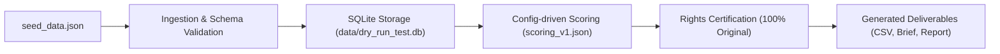

# Phase 0 Dry-Run Report

**Date:** 2026-10-10  
**Project:** LIDO AI Meditation Music Factory  
**Status:** Successfully Executed  
**Run ID:** `RUN_P0_20261010_011340`  

---

## 1. Dry-Run Objectives & Pipeline Validation

The Phase 0 dry-run verified the full end-to-end local-first workflow without making external API calls, executing paid actions, or downloading media content.

---

## 2. Ingestion & Validation Results

- **Input Source:** `fixtures/seed_data.json` (Offline Synthetic Fixture Protocol).
- **Channels Processed:** 2 records normalized (Vietnamese Niche: `UC_VN_MEDITATION_01`, International Niche: `UC_INT_CHILL_02`).
- **Videos Processed:** 4 records normalized with ISO-8601 UTC timestamps, durations, view counts, and tags.
- **Validation Checks Passed:**
  - Mandatory fields check (Title, Video ID, Channel ID, Published Timestamp).
  - Date format compliance (`YYYY-MM-DDTHH:MM:SSZ`).
  - Strict Data Lineage tagging (`provenance = 'SYNTHETIC_FIXTURE'`).

---

## 3. Database Population Summary

Database Location: `data/dry_run_test.db`

| Table Name | Row Count Inserted / Updated | Primary Key / Constraints Verified |
| :--- | :--- | :--- |
| `research_runs` | 1 | `RUN_P0_20261010_011340` (Mode: DRY_RUN) |
| `sources` | 1 | `SRC_SYNTHETIC_01` |
| `channels` | 2 | Unique Channel IDs |
| `videos` | 4 | Foreign Key to `channels` enforced |
| `video_snapshots` | 4 | Unique `(video_id, run_id)` |
| `topic_tags` | 7 | Category: `MEDITATION_NICHE` |
| `video_topic_tags` | 12 | Primary Key `(video_id, tag_id)` |
| `research_scores` | 4 | Composite opportunity scores |
| `creative_briefs` | 1 | `BRIEF_RUN_P0_20261010_011340` |
| `rights_records` | 1 | Original Work Certified: 100% |
| `qa_reviews` | 1 | Role: `CHATGPT_ARCHITECT` (Outcome: APPROVED) |
| `audit_events` | 2 | Run Started & Run Completed events |

---

## 4. Opportunity Scoring Output Matrix

| Rank | Video ID | Title Concept | Views | Engagement % | Composite Score | Provenance |
| :--- | :--- | :--- | :--- | :--- | :--- | :--- |
| 1 | `VID_VN_432HZ_001` | Nhạc Thiền 432Hz Giúp Giảm Stress | 350,000 | 3.83% | **58.74** | `SYNTHETIC_FIXTURE` |
| 2 | `VID_VN_528HZ_002` | Tần Số 528Hz Tái Tạo Năng Lượng | 180,000 | 4.23% | **53.11** | `SYNTHETIC_FIXTURE` |
| 3 | `VID_INT_DELTA_003` | Deep Sleep Music 432Hz - Rain | 1,250,000 | 4.09% | **46.72** | `SYNTHETIC_FIXTURE` |
| 4 | `VID_INT_PIANO_004` | Relaxing Piano & Soft Ocean Waves | 95,000 | 4.20% | **31.45** | `SYNTHETIC_FIXTURE` |

---

## 5. Artifact Deliverables Produced

1. **SQLite Database:** `data/dry_run_test.db`
2. **Tabular CSV Dataset:** `fixtures/sample_videos.csv`
3. **Sample Creative Brief:** `fixtures/sample_creative_brief.md`
4. **Sample Research Report:** `fixtures/sample_research_report.md`
